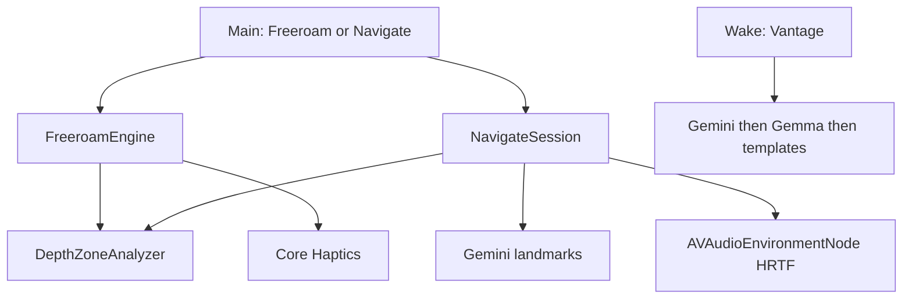

# Vantage — plan (shipped)

## Thesis

Chest-worn iPhone guide for blind and low-vision people. **Freeroam** watches the next few steps; **Navigate** uses camera landmarks (no MapKit / GPS). Cue restraint and honesty beat feature spam.

**Tagline:** *Know what’s ahead. Move with confidence.*

**Non-goals:** MapKit, place maps, turn-by-turn GPS, hand-to-object find/grab.

## Modes

### Freeroam

1. Haptics only while walking (near / medium / far; continuous close buzz).
2. Optional LiDAR night-vision overlay (voice toggle, local).
3. Voice only on ask (“Vantage…”).

### Navigate

1. Snapshot + goal → Gemini landmark step JSON.
2. Speak one step; HRTF tone toward coarse bearing (AirPods + head tracking).
3. Freeroam depth safety always underneath.
4. Unsure → say so; never invent street names.

## Spatial audio

- `CMHeadphoneMotionManager` + phone attitude → listener vs chest camera.
- `AVAudioEnvironmentNode` + `.HRTFHQ` places the tone in camera space.
- Freeroam does not spatialize (haptics carry the cue).

## Stack

| Layer | Role |
| --- | --- |
| ARKit LiDAR / monocular Vision | Depth zones |
| Gemini | Navigate + online Q&A |
| Gemma (LiteRT-LM) | Offline Q&A |
| ElevenLabs + phrase cache | Voice |
| Core Haptics | Freeroam primary cue |

## UI

Loading ripples → Main (Freeroam | Navigate) → session. Palette: ink / teal / cream (`app/Design/Brand.swift`).

## Accuracy rules

- Name on ask, not every frame.
- Zone hysteresis; chest-height band.
- Never block the safety loop on Gemini.
