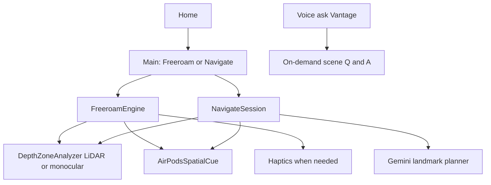

# Vantage v1 Plan

## Product thesis

**Vantage** is a calm, chest-worn iPhone guide for blind and low-vision people. Freeroam watches the path; Navigate uses camera landmarks (no map). Cue restraint, clear phases, and a high-contrast UI are core.

**Tagline:** *Know what’s ahead. Move with confidence.*

**v1 non-goals:** MapKit, place learning / environment maps, turn-by-turn GPS, hand-to-object find/grab pipelines.

**On-device LLM:** Gemma via Google LiteRT-LM (`.litertlm` in `app/Models/` — see `scripts/download_gemma.sh`).

## Two modes

### Freeroam

Passive companion while walking. Watches the next few steps; does **not** route.

**Cue hierarchy (current):**
1. **Primary:** Haptics only while walking (near/medium/far patterns, continuous close buzz).
2. **Optional:** LiDAR night-vision overlay (voice-toggle, no Gemini).
3. **Voice:** On ask (“Vantage…”) only — no automatic callouts while walking.

**Navigate** still uses **HRTF spatial audio** (`AVAudioEnvironmentNode`) with AirPods head tracking to pinpoint landmarks/hazards.

Includes: depth zones, smoothed ingest, stop distance, dodge wording, quiet mode, health check, on-device obstacle naming **on demand**.

### Navigate (no maps)

User names a destination (“pharmacy counter”, “exit to the street”, “room 214”). Gemini reads camera frames and returns short landmark steps — indoors or outdoors — without GPS or MapKit.

**Loop:**
1. Capture a framed snapshot + short context (mode, last step, goal).
2. Gemini returns landmark, next action, confidence, optional “I’m not sure”.
3. Vantage speaks one step; spatial tone can point toward a coarse left / ahead / right bearing.
4. Re-check on interval or when the user says “next” / “where am I” / “Vantage…”.
5. Freeroam depth safety stays **always on underneath** so obstacles never wait on Gemini.

**Honesty:** say when unsure; never invent street names; situational awareness, not a cane/dog replacement.

## AirPods / head tracking

- `CMHeadphoneMotionManager` + phone attitude → listener orientation (head relative to chest phone).
- Navigate: `AVAudioEnvironmentNode` + `.HRTFHQ` places a tone at the hazard/landmark in camera space.
- Freeroam: haptics-only (no spatial tone).
- Shared audio session (`.playAndRecord`) with the tone ducked under TTS.
- Offline phrases in `app/Phrases/` + runtime ElevenLabs disk cache (`Documents/TTSCache`).

## UI / visual identity

- Full-bleed brand home (mark + tagline + CTA) → main with **Freeroam** and **Navigate**.
- Loading screen and mode cards use soft ink/teal ripples.
- High contrast, large rounded type, one status surface, listening pill, calm motion.
- Camera session: clean preview + soft edge wash mirroring the ear cue; captions when speaking.
- Palette: deep ink + cool teal + warm off-white (`app/Design/Brand.swift`).

Screens: Loading → Home → Main → active session.

## Architecture (shipped)

| Area | Location |
| --- | --- |
| Depth / alerts / haptics / speaker / listener | `app/Core/` |
| Gemini + offline scene fallback | `app/Core/GeminiClient.swift`, `SceneAI.swift`, `OfflineAnswers.swift` |
| AirPods motion + spatial tone | `app/Spatial/` |
| Freeroam + Navigate | `app/Engine/` |
| Brand UI | `app/UI/`, `app/Design/` |
| XcodeGen project | `app/project.yml` |

Bundle ID: `com.vantage.app`. Secrets: `Secrets.swift.example` (Gemini + ElevenLabs).

## Offline answers (Gemma)

When Gemini is offline or fails, `SceneAI` calls **on-device Gemma** (`GemmaClient` + LiteRT-LM). The model sees the camera JPEG plus Apple Vision scene labels (vision encoder on CPU; language model on GPU, falling back to CPU). If the model file is missing, `OfflineAnswers` templates are the last resort.

Weights are **not** in git — download with `scripts/download_gemma.sh`.

## Non-Pro phones

When LiDAR is unavailable, `MonocularDistanceEstimator` uses Apple Vision (people + classifier) and assumed heights for coarse left/center/right distance. Not a custom Core ML obstacle model.

## Pitch

- Problem: phones are everywhere; many guides are loud, expensive, or map-dependent.
- What it does: Freeroam watches the path; Navigate uses on-device depth + Gemini landmarks to talk you through a building or block — no map.
- How: LiDAR (or monocular) zones, Freeroam haptics, Navigate HRTF + landmarks, calm voice on ask.
- Disclaimer: not a cane or guide dog replacement.

## Implementation checklist

- [x] Scaffold XcodeGen app, secrets, permissions, safety core, wake word “Vantage”
- [x] Brand shell (Loading / Home / Main) + Freeroam sparse cue policy
- [x] HRTF (`AVAudioEnvironmentNode` + `.HRTFHQ`) + headphone route + `CMHeadphoneMotionManager`
- [x] Navigate Gemini step loop; depth always underneath; Freeroam haptics-only
- [x] Voice ask path, quiet mode, announce hysteresis
- [x] Loading ripples (Vantage ink/teal)
- [x] README + phrase generator + Speaker ElevenLabs disk cache
- [x] On-device Gemma (LiteRT-LM) with download script
- [ ] Bundle offline `app/Phrases/*.mp3` once a valid ElevenLabs key is available
- [ ] Optional later: custom CV depth model

## Accuracy / overwhelm rules

- Longer announce cooldown; name on ask (or stable enter-in-path), not every frame.
- Freeroam: haptics only. Navigate: one HRTF tone + haptics — not beep + voice stacked.
- Zone hysteresis; chest-height depth band + confidence filters.
- Never block the safety loop on Gemini.
