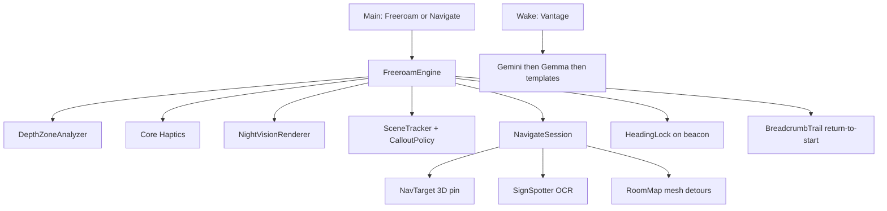

# Vantage — plan (shipped)

## Thesis

Chest-worn iPhone guide for blind and low-vision people. **Freeroam** watches the next few steps with sparse haptics (plus approach-only spoken callouts). **Navigate** pins a landmark in 3D and guides with a live beacon. Voice on ask. Honesty over feature spam.

**Tagline:** *Know what’s ahead. Move with confidence.*

**HackRU Fall 2026:** Social Good track. Demo Freeroam-first; Navigate is on (`Features.navigate = true`).

**Non-goals:** MapKit / GPS as the sole router. Hand-to-object find/grab.

## Freeroam

1. Haptics while walking (near / medium / far; continuous close buzz).
2. Sparse spoken callouts via `SceneTracker` + `CalloutPolicy` (approach-only; door / stairs / elevator earcon).
3. Voice commands: around me, repeat, lost / return to start (Clew-style crumbs), plus scene Q&A.
4. Optional night vision (voice toggle + Detection settings):
   - **Lit room:** translucent depth overlay on the live camera.
   - **Dark room:** auto full-frame opaque LiDAR (camera luma hysteresis).
   - **Imaging:** Color (distance rainbow) or **3D Spatial** (depth normals + lighting).

## Navigate (teammate stack + our heading)

Keep their loop: Gemini finds a landmark → LiDAR pins it (`NavTarget`) → `SignSpotter` OCR → `RoomMap` mesh A* detours → distance callouts + spatial beacon.

Ours on top: `HeadingLock` on the **live** beacon bearing (updates through turns/curves; not a frozen compass). Short start lines.

## Ask / offline

Gemini online → Gemma (LiteRT-LM) on device → Vision templates. Depth safety never waits on the network.

TTS: bundled `app/Phrases/` → `Documents/TTSCache` → ElevenLabs → system voice.

## UI

Loading ripples → Main (short first-launch greeting) → Freeroam / Navigate. Palette: ink / teal / cream (`app/Design/Brand.swift`). Huge targets; voice from launch.

## Accuracy rules

- Freeroam callouts on approach only, with cooldowns.
- Zone hysteresis; chest-height band.
- Never block the safety loop on Gemini.
