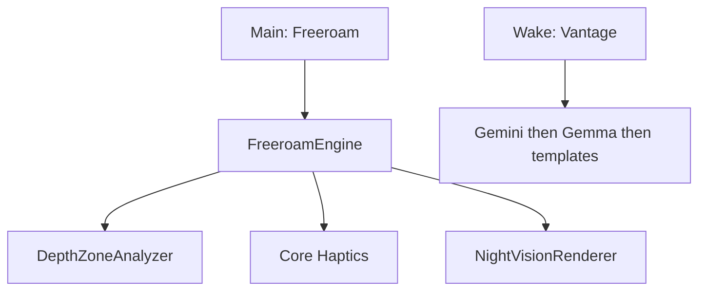

# Vantage — plan (shipped)

## Thesis

Chest-worn iPhone guide for blind and low-vision people. **Freeroam** watches the next few steps with sparse haptics. Voice on ask. Honesty over feature spam.

**Tagline:** *Know what’s ahead. Move with confidence.*

**HackRU Fall 2026:** Social Good track. Demo is Freeroam-first.

**Non-goals (current demo):** MapKit, GPS routing, hand-to-object find/grab. Landmark **Navigate** stays out of the UI (`Features.navigate = false` in `MainScreen.swift`) until the landmark loop is trustworthy. Engine / HRTF code remains under `app/Engine/NavigateSession.swift` and `app/Spatial/`.

## Freeroam

1. Haptics only while walking (near / medium / far; continuous close buzz).
2. Voice only on ask (“Vantage…”).
3. Optional night vision (voice toggle + Detection settings):
   - **Lit room:** translucent depth overlay on the live camera.
   - **Dark room:** auto full-frame opaque LiDAR (camera luma hysteresis).
   - **Imaging:** Color (distance rainbow) or **3D Spatial** (depth normals + lighting).

## Ask / offline

Gemini online → Gemma (LiteRT-LM) on device → Vision templates. Depth safety never waits on the network.

TTS: bundled `app/Phrases/` → `Documents/TTSCache` → ElevenLabs → system voice.

## UI

Loading ripples → Main (Start / Freeroam) → session. Palette: ink / teal / cream (`app/Design/Brand.swift`). Huge targets; voice from launch.

## Accuracy rules

- Name on ask, not every frame.
- Zone hysteresis; chest-height band.
- Never block the safety loop on Gemini.
