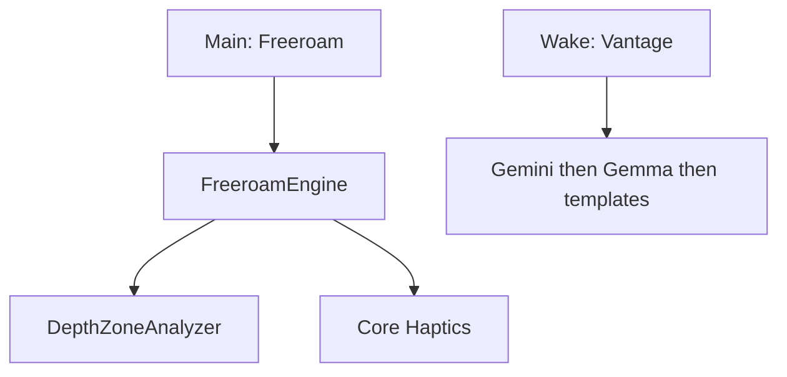

# Vantage — plan (shipped)

## Thesis

Chest-worn iPhone guide for blind and low-vision people. **Freeroam** watches the next few steps with sparse haptics. Voice on ask. Honesty over feature spam.

**Tagline:** *Know what’s ahead. Move with confidence.*

**Non-goals (v1 demo):** MapKit, GPS routing, hand-to-object find/grab. Landmark **Navigate** is deferred (`Features.navigate = false`) until it’s trustworthy.

## Freeroam

1. Haptics only while walking (near / medium / far; continuous close buzz).
2. Optional LiDAR night-vision overlay (voice toggle, local).
3. Voice only on ask (“Vantage…”).

## Ask / offline

Gemini online → Gemma (LiteRT-LM) on device → Vision templates. Depth safety never waits on the network.

## UI

Loading ripples → Main → Freeroam session. Palette: ink / teal / cream (`app/Design/Brand.swift`). Huge mode cards; voice from launch.

## Accuracy rules

- Name on ask, not every frame.
- Zone hysteresis; chest-height band.
- Never block the safety loop on Gemini.
