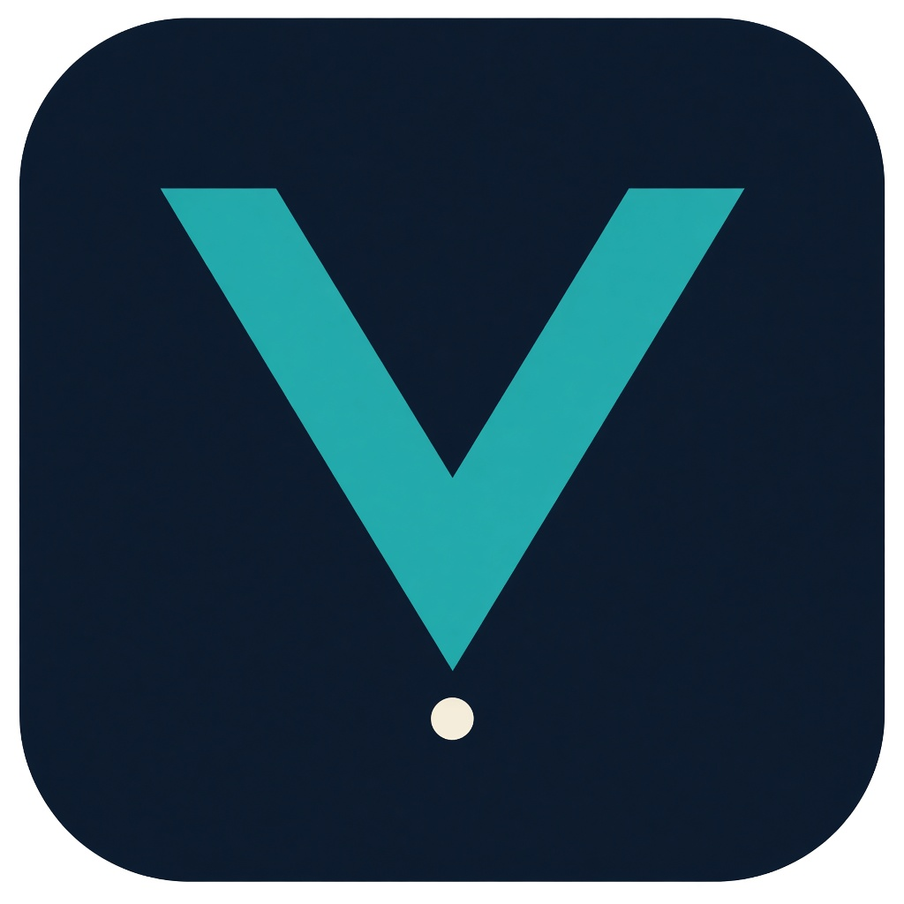
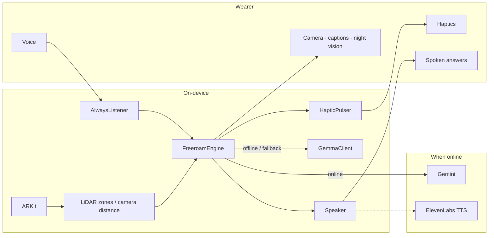

<div align="center">



# Vantage

### A chest-worn iPhone guide for blind and low-vision people

*Feel the path ahead, understand what's in front of you, and move with confidence — even when Wi‑Fi drops.*

<p>
  
  
  
  
  
  
  
  
  
</p>

<sub>Built at <b>HackRU Fall 2026</b> · Busch Student Center · Oct 10–11, 2026</sub>

</div>

---

## Overview

Vantage is a voice-first guide worn on a chest lanyard. **Freeroam** watches the next few steps with LiDAR (or camera) depth and calm haptics. Say **"Vantage, …"** when you want the world named out loud.

> The phone handles danger locally. AI helps Vantage understand the view — it never owns the safety loop.

1. **Watches** left / ahead / right — LiDAR when available, camera distance when not.
2. **Feels** — near / medium / far haptic bands; continuous buzz when something is very close. No beeps.
3. **Asks** — wake word *"Vantage…"* for what's ahead, naming, and short scene answers.
4. **Answers** with Gemini when online, on-device Gemma when offline, then Vision templates.
5. **Night vision** — local LiDAR depth overlay, toggled by voice (no cloud).

Vantage doesn't replace a cane or a guide dog. It adds another sense to a phone people already carry.

---

## Highlights

| | |
|---|---|
| **Offline safety** | Depth + haptics run on the phone. No network needed to feel *"too close."* |
| **Any modern iPhone** | LiDAR Pro preferred. Without it, Vision estimates distance from the camera. |
| **Gemini + Gemma** | Gemini when you're online; on-device Gemma when you're not. |
| **Calm ElevenLabs voice** | Speaks on ask; system voice fallback if the network fails. |
| **Always listening** | Wake word *"Vantage…"* — interrupt anytime. |
| **Quiet mode** | Haptics only. |
| **Blind-first UI** | Voice from launch, huge mode cards, ink / teal / cream, VoiceOver-friendly. |

---

## Architecture



**Safety never waits on the network.** Depth decides *where*; Vision / Gemini / Gemma decide *what*.

---

## Voice commands

Always start with **"Vantage, …"**

| Say | Vantage does |
|---|---|
| `Vantage` | Ready — ask what's ahead |
| `… what's ahead?` / `what's in front of me?` | Describes the camera view |
| `… name that` / `what is that?` | Names the nearest obstacle |
| `… quiet on` / `speaking on` | Haptics-only or speak again |
| `… night vision on` / `off` | LiDAR depth overlay |
| `… go back` / `main menu` | Leaves the session |

---

## Quick start

```bash
git clone https://github.com/prathamwankhede/Vantage.git
cd Vantage
brew install xcodegen git-lfs && git lfs install
./scripts/download_gemma.sh   # optional on-device Gemma
cd app
cp Secrets.swift.example Secrets.swift
cp Local.xcconfig.example Local.xcconfig
xcodegen generate
open Vantage.xcodeproj
```

1. Add Gemini + ElevenLabs keys in `Secrets.swift`.
2. Set your `DEVELOPMENT_TEAM` in `Local.xcconfig`.
3. Run on a **physical iPhone**. Allow Camera, Mic, Speech, Motion.
4. Say **"Start"** or tap Freeroam, then **"Vantage, what's ahead?"**

Optional phrase bank:

```bash
python3 scripts/generate_phrases.py
```

More detail: [`app/SETUP.md`](app/SETUP.md) · Devpost paste: [`DEVPOST.md`](DEVPOST.md)

---

## Repo map

| Piece | Role |
|---|---|
| `app/Engine/FreeroamEngine.swift` | Safety loop, wake word, scene Q&A |
| `app/Core/DepthZoneAnalyzer.swift` | LiDAR left / center / right |
| `app/Core/MonocularDistanceEstimator.swift` | Camera-only distance (no LiDAR) |
| `app/Core/HapticPulser.swift` | Near / medium / far bands |
| `app/Core/NightVisionRenderer.swift` | LiDAR depth overlay |
| `app/Core/SceneAI.swift` | Gemini → Gemma → templates |
| `app/Core/GemmaClient.swift` | On-device scene answers |
| `app/Core/GeminiClient.swift` | Cloud vision Q&A |
| `app/Core/Speaker.swift` | ElevenLabs + cache + system voice |
| `app/Core/AlwaysListener.swift` | Wake-word listening |
| `app/UI/` | Loading, main menu, session |
| `docs/branding/` | Logo + Devpost thumbnail |
| `scripts/` | Gemma download + phrase generator |

---

## Built with

ARKit · Core Haptics · Apple Vision · Apple Speech · ElevenLabs · Google Gemini · Gemma (LiteRT-LM) · SwiftUI · XcodeGen

---

## Team · HackRU Fall 2026

| Name | Links |
|---|---|
| **Farhan Mir** | [GitHub](https://github.com/farhanmir) · [LinkedIn](https://www.linkedin.com/in/farhan-mir) |
| **Pratham Wankhede** | [GitHub](https://github.com/prathamwankhede) |

---

<div align="center">

**Know what's ahead. Move with confidence.**

<sub>Not a replacement for a cane or guide dog — a 24-hour prototype that adds another sense.</sub>

</div>
